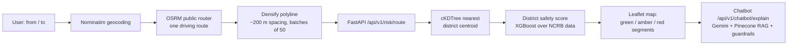

# MapLY

Safety-aware navigation for women in India. MapLY takes a normal driving route and colours every stretch of it by a district-level safety score built from NCRB crime-against-women statistics, then lets the user ask an LLM assistant to explain why an area is rated the way it is. It also has an SOS flow that streams the user's GPS location to the backend over a WebSocket.

Team project by Aadvik Chaturvedi and Ankush (`Ankushsv`). See [My contributions](#my-contributions).

## How it works



1. **Routing.** The frontend geocodes text with Nominatim and asks the public OSRM demo server for one driving route (`maply/lib/routing.js`, `alternatives=false`). MapLY does not compute its own shortest path; it scores the route OSRM returns.
2. **Spatial lookup.** The route is densified to ~200 m spacing (`maply/lib/geo.ts`) and sent in batches of 50 points to `POST /api/v1/risk/route`. The backend snaps each point to the nearest of 345 district centroids across 30 states/UTs (`district_centroids.json`) using a SciPy `cKDTree`, and returns `risk_score = 1 - safety_score / 100` per point.
3. **Risk scores.** At startup the backend loads the NCRB CSVs in `data/` (2001–2015), engineers features (total crimes, domestic-violence and public-safety ratios), builds a severity-weighted `Safety_Score` (0–100), fits an XGBoost regressor on it, and buckets the result into Low (≥80), Moderate (≥60) and High risk.
4. **Explanation.** `POST /api/v1/chatbot/explain` looks up a district's score and asks Gemini (`gemini-2.0-flash-exp`) to explain it, with context retrieved from a Pinecone index (Gemini `text-embedding-004`, 768-d, top-k 2–3) built from `chatbot/knowledge_base.md`. A regex guardrail rewrites phrases like "completely safe" or "no risk" into the actual score and category, and every response gets a fixed disclaimer.
5. **SOS.** `useSOS.ts` opens a WebSocket straight to FastAPI (`/ws/sos`) and sends location on an interval, with an HTTP fallback through the Next.js `/api/sos` route.

## Risk model results

From `ml_services/notebooks/riskScoreEngine.ipynb`. The five NCRB files combine to 22,207 district-year rows (11,530 after de-duplication); 20,854 rows remain after removing aggregate "TOTAL" rows.

Pooled models, 80/20 split grouped by district (`GroupShuffleSplit`), target `Safety_Score`:

| Model | Train R² | Test R² | Test RMSE |
|---|---|---|---|
| Ridge (alpha=10) | 0.9832 | 0.9847 | 0.956 |
| XGBoost (depth 2, heavily regularised) | 0.9513 | 0.8783 | 2.699 |
| Random Forest (depth 3) | 0.7422 | 0.6013 | 4.884 |

Ridge 5-fold CV: mean R² 0.9832 (±0.0031), mean RMSE 0.877.

Per-region Ridge models: 689 district models (mean test R² 0.5486, mean test RMSE 0.3506) and 64 state models (mean test R² 0.9598, mean test RMSE 0.4101).

Read these numbers with the caveat in [Limitations](#limitations--next-steps): the target is itself a weighted formula over the same crime counts the features come from, so high R² mostly means the model recovers that formula.

## Other ML pieces

- **Sentiment:** `distilbert-base-uncased-finetuned-sst-2-english` served at `POST /api/v1/sentiment/predict` and `/batch`. It returns label, confidence, probabilities and a `[-1, 1]` score. It is not yet fed back into the risk score (the `LEARNING_RATE_LAMBDA` adjustment in `Sentiment_Analysis/config.py` is defined but not used).
- **Chatbot fallbacks:** if `PINECONE_API_KEY` is missing it falls back to a keyword-retrieval RAG bot, then to a plain Gemini explainer, then to a templated explanation.

## Repository layout

```
MapLY/
├── maply/          Next.js 16 / React 19 / TS frontend (Leaflet, Zustand, Tailwind v4)
│   ├── app/api/    Route handlers proxying to FastAPI: predict, risk-score, sos, reports
│   ├── lib/        routing (OSRM), geocode (Nominatim), geo (haversine, densify, chunk)
│   └── hooks/      useSOS (WebSocket + HTTP fallback), useLocation
├── ml_services/    FastAPI backend
│   ├── Risk_Score_Engine/   XGBoost risk model + cKDTree centroid lookup
│   ├── Sentiment_Analysis/  DistilBERT wrapper
│   ├── chatbot/             Gemini + Pinecone RAG, guardrails
│   ├── notebooks/           riskScoreEngine.ipynb (model exploration)
│   └── tests/               pytest suites
├── data/           NCRB crimes-against-women CSVs
└── .github/workflows/ci.yml
```

## API

| Endpoint | Description |
|---|---|
| `GET /health` | Status of sentiment model, risk engine, region count, chatbot |
| `GET /metrics` | Request counts, error rates, timings |
| `GET /api/v1/risk/scores?state=` | All risk records, optional state filter |
| `GET /api/v1/risk/location?state=&district=` | Risk for one district |
| `GET /api/v1/risk/states`, `/api/v1/risk/districts?state=` | Lookup lists |
| `GET /api/v1/risk/coordinate?lat=&lng=` | Nearest-district risk for a point |
| `POST /api/v1/risk/route` | `{"coordinates": [[lat, lng], ...]}` → per-point risk |
| `POST /api/v1/sentiment/predict`, `/batch` | DistilBERT sentiment |
| `POST /api/v1/chatbot/explain` | `{state, district, context?, include_technical?}` → explanation |
| `GET /api/v1/chatbot/health` | Which chatbot variant is loaded |
| `POST /api/v1/sos`, `GET /api/v1/sos/events` | SOS HTTP fallback, recent events (in memory) |
| `POST /api/v1/reports`, `GET /api/v1/reports` | Community reports with haversine radius filter (in memory) |
| `WS /ws/sos` | SOS location over WebSocket |

Interactive docs at `http://localhost:8000/docs`.

## Running locally

Requirements: Node.js 20+, Python 3.11+, Docker optional.

**Backend**

```bash
cd ml_services
cp .env.example .env        # add your own GEMINI_API_KEY / PINECONE_API_KEY
python3 -m venv .venv && source .venv/bin/activate
pip install -r requirements.txt
uvicorn api.main:app --reload --host 0.0.0.0 --port 8000
```

The risk model trains on the CSVs in `../data` at startup, and the DistilBERT weights download on first run.

To populate the Pinecone index once: `python -m chatbot.pinecone_kb` (runs `setup_knowledge_base()`).

**Frontend**

```bash
cd maply
npm install
npm run dev                 # http://localhost:3000
```

**Docker (backend only)**

```bash
cd ml_services
docker-compose up -d        # mounts ../data read-only, healthcheck on /health
```

### Configuration

| Variable | Where | Default | Purpose |
|---|---|---|---|
| `NEXT_PUBLIC_FASTAPI_URL` | frontend | `http://localhost:8000` | Backend base URL (also used to derive the WebSocket URL) |
| `GEMINI_API_KEY` | backend | none | Gemini generation and embeddings |
| `PINECONE_API_KEY` | backend | none | Enables the Pinecone RAG chatbot |
| `CORS_ORIGINS` | backend | `http://localhost:3000,...` | Allowed origins |
| `API_HOST` / `API_PORT` | backend | `0.0.0.0` / `8000` | Server bind |
| `SENTIMENT_MODEL_NAME` | backend | DistilBERT SST-2 | Sentiment model |

### Checks

| Command | Directory | |
|---|---|---|
| `npm run lint`, `npm run typecheck` | `maply/` | ESLint, `tsc --noEmit` |
| `pytest tests/ -v --cov` | `ml_services/` | Risk engine, spatial lookup, sentiment, chatbot guardrails |
| `flake8 .` | `ml_services/` | Lint |

CI (`.github/workflows/ci.yml`) runs both jobs on pushes and PRs to `main`.

## My contributions

From `git log` (13 of the 23 commits are mine; Ankush's work is listed for context).

**Aadvik**
- Risk score research notebook (`riskScoreEngine.ipynb`): merging the five NCRB datasets, feature engineering, XGBoost / Ridge / RF comparison, per-district and per-state models.
- The whole `ml_services` backend: FastAPI app, schemas, logging/metrics middleware, risk score engine, DistilBERT sentiment service, tests, Dockerfile, docker-compose, scripts.
- Chatbot: Gemini explainer, keyword RAG and Pinecone RAG variants, knowledge base, Pinecone indexing.
- Frontend–backend integration (commit `9d654c1`): coordinate and route risk endpoints with the cKDTree centroid index and `district_centroids.json`, WebSocket + HTTP SOS on both ends (`useSOS.ts`, `/ws/sos`), community reports API, polyline densification helpers, Zustand store, heatmap / legend / safe-route map components, chatbot guardrails and their tests, CI workflow.

**Ankush**
- Next.js app scaffold, UI (landing page, navbar, footer, Radix/shadcn components), and the first version of the route planner with OSRM routing, Nominatim geocoding and per-district risk colouring.

## Limitations / next steps

- **Circular target.** `Safety_Score` is a min-max-scaled weighted sum of crime counts, and the features are derived from the same counts. The model reproduces a hand-built index; it does not predict an independent outcome. A real label (incident reports by location and time, for example) is needed before the metrics mean much.
- **Coarse spatial resolution.** Every point snaps to the nearest district centroid, so a whole district gets one score. Districts missing from the centroid table fall back to a New Delhi centroid.
- **No safety-aware routing yet.** OSRM returns one route and MapLY colours it. The planner's "priority" option does not change the route. Requesting OSRM alternatives and choosing by summed segment risk would be the obvious next step.
- **Unsafe fallback.** If a risk batch request fails, `SafetyMap.tsx` marks those points as "Low Risk" with score 0. They should be shown as unknown.
- **Static, old data.** NCRB figures cover 2001–2015 and the model retrains on every startup.
- **Prototype auth and storage.** SOS uses a hard-coded mock token, and SOS events and reports live in process memory. Sentiment is not yet wired into the risk score.
- The chatbot depends on external Gemini and Pinecone APIs and an experimental Gemini model name.

## License

See [LICENSE](LICENSE).
